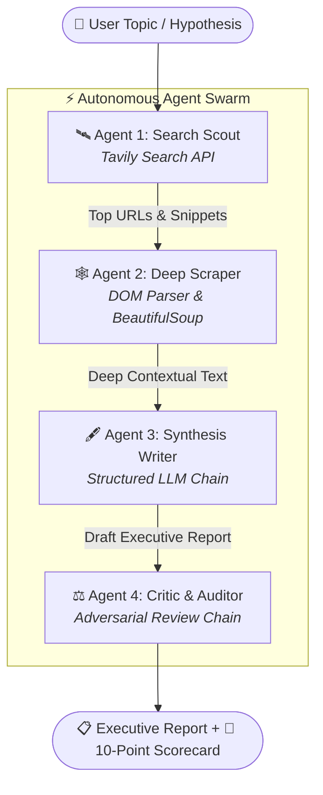

<div align="center">

# ⚡ AGENTIS AI • Multi-Agent Research Swarm

**Autonomous 4-Agent Intelligence Pipeline for Real-Time Deep Web Discovery, Extraction, Synthesis & Adversarial Auditing.**

[](https://www.python.org/)
[](https://python.langchain.com/)
[](https://groq.com/)
[](https://tavily.com/)
[](https://streamlit.io/)

</div>

---

## 📌 Overview

**Agentis** is a modular, autonomous multi-agent research framework built with **LangChain**, **Groq**, and **Streamlit**. 

Instead of relying on a single monolithic prompt, Agentis delegates specialized tasks to a coordinated swarm of 4 discrete AI agents and chains. Together, they gather live web intelligence, deep-scrape primary documents, author structured executive briefings, and perform adversarial fact-checking with a strict 10-point scorecard.

---

## 🏗️ System Architecture & Workflow



### The 4 Specialized Agents:

| Agent / Chain | Primary Engine | Role & Responsibility |
| :--- | :--- | :--- |
| **🛰️ Search Scout** | `Tavily Search API` | Queries live web indices, retrieves high-authority sources, extracts snippets, and filters noise. |
| **🕸️ Deep Scraper** | `BeautifulSoup` + `Requests` | Selects the most relevant URL, strips non-content DOM elements (scripts, styles, navs), and extracts clean text. |
| **🖋️ Synthesis Writer** | `ChatGroq` Chain | Synthesizes search snippets and scraped page context into an executive report with introduction, findings, and citations. |
| **⚖️ Critic & Auditor** | `ChatGroq` Analytical Chain | Adversarially scores the report across 4 weighted metrics, flags unsupported claims/hallucinations, and produces a final verdict. |

---

## 🎯 Critic Evaluation Rubric

The Critic agent applies a strict weighted rubric to score and audit every generated report:

- **Accuracy (30%)**: Are factual figures supported? Contradictions or misleading claims detected?
- **Completeness (25%)**: Are critical industry/technical angles covered without missing perspectives?
- **Depth & Insight (25%)**: Does the report reveal structural patterns rather than superficial summaries?
- **Structure & Clarity (20%)**: Logical flow, readable hierarchy, and verifiable source citations.

In addition to calculating an overall score out of 10, the Critic produces:
- ✅ **Verified Strengths**
- ⚠️ **Actionable Areas for Improvement**
- 🛡️ **Hallucination Risk & Unsupported Claims Check**
- 🏁 **Final Executive Verdict**

---

## 🚀 Getting Started

### 1. Prerequisites

- Python 3.10, 3.11, or 3.12
- [Groq API Key](https://console.groq.com/) (Fast LLM inference)
- [Tavily API Key](https://app.tavily.com/) (AI-native search engine)

### 2. Clone and Setup Environment

```bash
# Clone the repository
git clone https://github.com/your-username/multi-agent-system.git
cd multi-agent-system

# Create and activate a virtual environment
python3 -m venv .venv
source .venv/bin/activate  # On Windows: .venv\Scripts\activate

# Install dependencies
pip install -r requirements.txt
```

### 3. Configure API Keys

Copy the example environment file and add your API keys:

```bash
cp .env.example .env
```

Edit `.env` and fill in your keys:

```env
GROQ_API_KEY=gsk_your_groq_api_key_here
TAVILY_API_KEY=tvly-your_tavily_api_key_here
```

---

## 💻 Running the Application

### Option A: Modern Cyber Web Studio (Recommended)

Launch the interactive Streamlit dashboard:

```bash
streamlit run app.py
```

Open `http://localhost:8501` in your browser.

#### Features in the Web UI:
- **Live Agent Status Matrix**: Watch each agent shift states (`Idle` ➔ `Working...` (animated pulse) ➔ `Completed ✓`).
- **Interactive Preset Chips**: Fast one-click queries (`Autonomous Multi-Agent Workflows`, `Solid-State Batteries`, etc.).
- **Dual Pipeline Modes**:
  - `🚀 Live Multi-Agent Pipeline`: Executes live Groq LLM + Tavily searches.
  - `🧪 Interactive Demo Mode`: Instant zero-cost simulation for previews and testing.
- **Export Options**: Download generated reports as Markdown (`.md`) or raw text.
- **Evidence Inspector**: View indexed snippets, raw scraped DOM text, and full JSON session states.
- **Session History**: Switch between previously generated reports in the sidebar.

---

### Option B: Command-Line Interface (CLI)

Run the terminal-based pipeline directly:

```bash
python pipeline.py
```

You will be prompted to enter a research topic:
```text
Enter the research topic: Quantum Computing Breakthroughs in Cryptography
==================================================
Step 1: search agent is working ...
==================================================
...
```

---

### Option C: Standalone Tool Inspection

Test individual tools directly:

```bash
python tools.py
```

---

## 📂 Project Structure

```text
multi-agent-system/
├── app.py                  # Streamlit Web UI (Glassmorphic dashboard & live swarm runner)
├── agents.py               # Agent definitions, prompts, writer & critic chains
├── pipeline.py             # CLI pipeline orchestrating the 4-agent sequential workflow
├── tools.py                # Tavily search tool and BeautifulSoup DOM scraper
├── requirements.txt        # Python package dependencies
├── .env.example            # Environment variable template
├── .gitignore              # Git ignore rules (secrets, venvs, caches)
└── .streamlit/
    └── config.toml         # Streamlit server and dark-theme configurations
```

---

## 🛠️ Configuration & Customization

### Modifying the LLM Model
In [agents.py](file:///Volumes/Rish%20SSD/projects/learning/multi-agent-system/agents.py) (or via the sidebar dropdown in `app.py`), you can select any Groq-supported model:
- `openai/gpt-oss-120b` (Default)
- `llama-3.3-70b-versatile`
- `llama-3.1-8b-instant`
- `mixtral-8x7b-32768`

### Adjusting Scraping & Search Depth
In [tools.py](file:///Volumes/Rish%20SSD/projects/learning/multi-agent-system/tools.py):
- Change `max_results=5` in `get_search` to increase search coverage.
- Adjust the character slice `[:3000]` in `scrape_url` to ingest longer or shorter web articles.

---

## 🛡️ License

Distributed under the MIT License. See `LICENSE` for more information.

